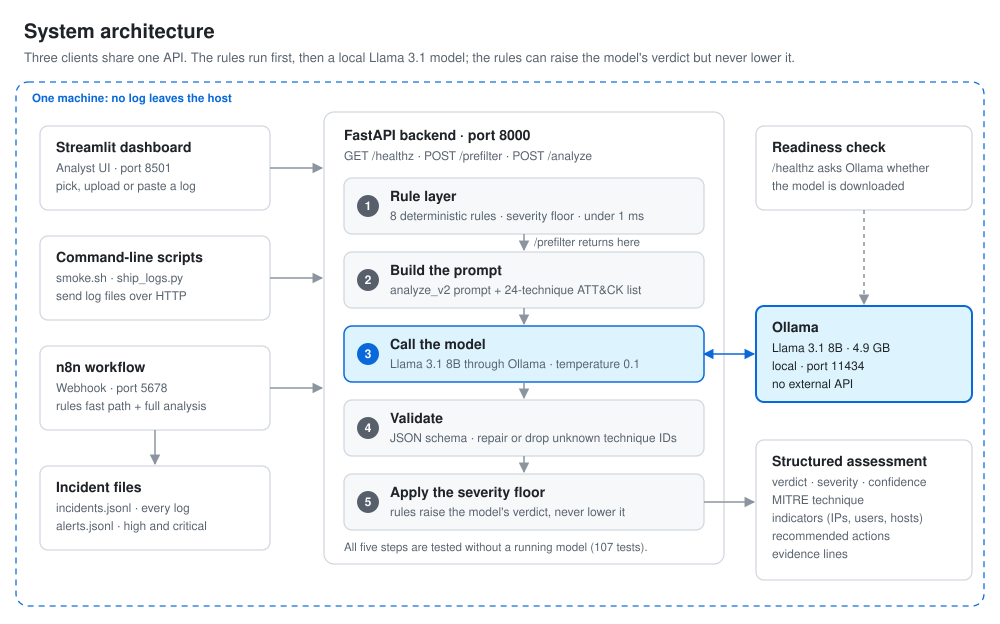

# AI-Powered Incident Response and Security Log Analysis System

[](https://doi.org/10.5281/zenodo.23331566)

Local-first SOC log analysis: raw log text in, a structured threat assessment out.
Inference runs on your own machine via Ollama, so log data never leaves the host.

Implements the full build plan: the FastAPI + Ollama core with structured output,
the deterministic pre-filter, the Streamlit dashboard, the evaluation harness and
the n8n triage workflow.

To cite it, use the archived release on Zenodo: Antar, R. A. (2026). *AI-Powered
Incident Response and Security Log Analysis System* (v1.0.1).
https://doi.org/10.5281/zenodo.23331566

See the project report (`1791647043721_AI.docx`) for the full design.

## Architecture



The dashboard, n8n and the shell scripts all call the same API, so they get
identical results. The evaluation harness (`scripts/evaluate.py`) imports the
same rule and model code directly instead of going over HTTP. `/prefilter` stops
after the rules (step 1); `/analyze` runs all five steps. Only step 3 needs
Ollama, and it runs on the same machine.

## Status

| Component | State |
|---|---|
| FastAPI backend (`/`, `/healthz`, `/analyze`) | done |
| Ollama / Llama 3.1 integration | done |
| Structured JSON assessment (severity, MITRE, IOCs) | done |
| MITRE catalogue (constrains prompt, repairs output) | done |
| Deterministic pre-filter (8 rules, severity floor) | done |
| Log corpus | 6 dev + 29 held-out samples, labelled |
| Evaluation harness | done (`scripts/evaluate.py`) |
| Test suite | 107 tests, runs without Ollama |
| Streamlit dashboard | done |
| n8n triage workflow | done |

## Setup

Install Ollama and pull the model (one time). No Homebrew or sudo needed —
this installs into your own `~/Applications`:

```bash
curl -L -o /tmp/Ollama-darwin.zip https://ollama.com/download/Ollama-darwin.zip
unzip -q /tmp/Ollama-darwin.zip -d ~/Applications/
ln -sf ~/Applications/Ollama.app/Contents/Resources/ollama ~/.local/bin/ollama
```

Then start the server and pull the model:

```bash
ollama serve &          # leave running
ollama pull llama3.1:8b
```

> Homebrew is not a usable route on this machine: `/opt/homebrew` is owned by a
> different user account, and brew does not support macOS 27. The zip above is
> the official signed build (Developer ID: Infra Technologies, Inc, 3MU9H2V9Y9).

Install Python dependencies:

```bash
python3 -m venv .venv
.venv/bin/pip install -r requirements.txt
cp .env.example .env    # adjust if your Ollama host or model differs
```

## Run

```bash
.venv/bin/uvicorn app.main:app --reload
```

- Interactive API docs: http://localhost:8000/docs
- Readiness (checks Ollama *and* that the model is pulled): http://localhost:8000/healthz

## Analyze a log

```bash
curl -X POST http://localhost:8000/analyze \
  -H 'Content-Type: application/json' \
  -d '{"log": "Failed password for invalid user admin from 102.54.12.21", "source": "auth.log"}'
```

Or run a whole sample file through it:

```bash
scripts/smoke.sh data/samples/auth_brute_force.log
```

Response shape:

```json
{
  "response": "Repeated failed SSH logins from a single source IP...",
  "analysis": {
    "verdict": "malicious",
    "severity": "high",
    "attack_type": "SSH brute force",
    "confidence": 0.9,
    "mitre": {"technique_id": "T1110", "technique_name": "Brute Force"},
    "indicators": {"ips": ["102.54.12.21"], "users": ["admin", "root"], "hosts": [], "processes": [], "files": []},
    "summary": "...",
    "recommendations": ["Block 102.54.12.21 at the perimeter."],
    "supporting_lines": ["Failed password for invalid user admin..."]
  },
  "model": "llama3.1:8b",
  "prompt_version": "analyze_v1",
  "latency_ms": 4120
}
```

`response` is kept as a plain-text field so the API contract documented in the
report (§4.1) still holds; `analysis` is the structured form that the dashboard,
n8n and the evaluation harness all consume.

## Dashboard

With the API running (see **Run**), in a second terminal:

```bash
.venv/bin/streamlit run dashboard/app.py
```

Opens at http://localhost:8501. Point it at another API with `SOC_API=http://host:8000`.

- **Input:** pick any dev or held-out corpus sample, upload a file, or paste lines.
- **Rules only** calls `/prefilter`: under a millisecond, no model. When no rule
  fires it says so rather than calling the log benign, since 8 narrow rules
  cannot vouch for a log.
- **Full analysis** calls `/analyze` (~15–30s): verdict, severity, MITRE link,
  evidence lines, indicators, recommendations, and the rule signals beside them.
  A banner shows when the rules raised the model's severity.
- **Against the label:** for corpus samples, the result is scored the same way
  `scripts/evaluate.py` scores it. On `samples/` that is agreement with the dev
  set the detector was written against, not accuracy; the page says so.

The sidebar shows engine state from `/healthz`; with Ollama down, rules-only
still works and full analysis is disabled.

The dashboard calls the API over HTTP rather than importing `app`, so it shows
exactly what any other client gets. `tests/test_dashboard.py` routes those calls
into the in-process API (model stubbed), so a mismatch between the API's
response shape and what the dashboard reads fails the suite.

## Automation (n8n)

`n8n/soc_triage.json` turns the API into an alerting pipeline. Each log posted
to its webhook goes through it like this:

```
webhook ─► Prepare ─┬─► /prefilter ─► high/critical? ─► rule alert ─────────┐
                    │                                                        ├─► alerts.jsonl
                    └─► /analyze ─► incident record ─┬─► high/critical? ─► model alert
                          │                          ├─► incidents.jsonl
                          │ (fails)                  └─► reply to caller
                          └─► error record ─► incidents.jsonl, reply 502
```

**Every log goes to the model, not only the ones the rules flag.** On the
held-out set the rules catch a third of the attacks, so screening with them
would hide two-thirds from the model. The rules are a fast path instead: a high
or critical hit is written to `alerts.jsonl` within milliseconds, while the
model takes about 15 seconds to produce its own record.

Setup: n8n 2.x needs Node 24, and its `isolated-vm` dependency does not build on
Node 25. On this machine it is installed with the official Node 24 build in
`~/.local/opt/node24`, n8n in `~/.local/share/n8n`, and a wrapper at
`~/.local/bin/n8n`. Elsewhere, `npm install -g n8n` under Node 24 does the same.

```bash
.venv/bin/uvicorn app.main:app            # terminal 1: the API
n8n/start.sh                              # terminal 2: imports, publishes, starts n8n
.venv/bin/python scripts/ship_logs.py data/holdout/*.log   # terminal 3
```

`start.sh` re-imports the workflow on every start, so edits made in the n8n
editor (http://localhost:5678) are overwritten. To keep them, export them to
`n8n/soc_triage.json` first. n8n may only read and write under `data/incidents/`
(`N8N_RESTRICT_FILE_ACCESS_TO`). The webhook replies once the model has
finished, which is what paces the shipper.

## Test

```bash
.venv/bin/python -m pytest tests/ -q
```

107 tests, no Ollama and no network required — verify that claim with:

```bash
OLLAMA_HOST=http://localhost:9 .venv/bin/python -m pytest tests/ -q
```

Two layers of coverage:

- The `/analyze` route tests replace `llm.analyze` outright, covering request
  validation and the 503/502 error paths.
- `tests/test_llm.py` drives the **real** `llm.analyze` through
  `httpx.MockTransport` with recorded Ollama response bodies in
  `tests/fixtures/`, so the parse -> validate -> `mitre.normalize` chain is
  covered without a server. That includes the observed failure modes: prose
  instead of JSON, a schema violation, an invented technique ID, and a
  technique name the catalogue has to correct.

What the suite does *not* measure is model accuracy — it never consults the
model. That is what `scripts/evaluate.py` is for.

## Layout

```
app/
  main.py              FastAPI routes
  llm.py               Ollama client; validates the model's JSON
  models.py            request/response + Analysis schema
  config.py            environment-driven settings
  mitre.py             curated ATT&CK catalogue for log analysis
  prefilter.py         deterministic rules + severity floor
  prompts/
    analyze_v1.txt     v1: plain instructions (kept for comparison)
    analyze_v2.txt     v2: escalation rules + few-shot (default)
    analyze_v3.txt     v3: v2 plus a failure threshold; measured worse, kept as evidence
dashboard/
  app.py               Streamlit UI; talks to the API over HTTP
  client.py            API calls, corpus, label scoring (no Streamlit)
data/samples/          dev corpus (detector written against these)
data/holdout/          held-out corpus, 29 labelled samples
data/eval/             evaluation output, per dataset
scripts/evaluate.py    scores rules / model / combined against the labels
scripts/smoke.sh       end-to-end check against a running API
scripts/ship_logs.py   sends log files to the n8n workflow (stands in for a collector)
n8n/
  soc_triage.json      the triage workflow
  start.sh             imports, publishes and starts it
tests/
  helpers.py           MockTransport plumbing shared by the test modules
  fixtures/            recorded Ollama response bodies
  test_api.py          routes, including /healthz
  test_llm.py          the real Ollama call path
  test_mitre.py        catalogue lookup and repair; prompt examples vs the rules
  test_prefilter.py    every rule, both directions
  test_corpus.py       label integrity: unscoreable labels fail the build
  test_dashboard.py    dashboard client and AppTest runs against the in-process API
  test_n8n.py          workflow wiring, and API fields it reads vs the response models
```

## Evaluation

Two datasets, because a score on logs you wrote the detector against means
something different from a score on logs you did not:

| dataset | what it is |
|---|---|
| `data/samples/` | 6 samples. The rules and prompts were written against these. A high score here measures agreement, not skill. |
| `data/holdout/` | 29 samples (18 attack / 11 benign). Web, cloud, Windows, DNS, firewall and container logs the rules were never written for, plus 11 benign samples — 5 of them built as traps for specific rules. |

```bash
.venv/bin/python scripts/evaluate.py                                    # dev set
.venv/bin/python scripts/evaluate.py --dataset holdout --versions ""    # rules only, instant
.venv/bin/python scripts/evaluate.py --dataset holdout --versions analyze_v2,analyze_v3
```

Precision and recall below are over attack-vs-benign — the decision an analyst
acts on. FP counts benign samples reported as an attack.

**Dev set** (6 samples):

| configuration | fields | precision | recall | FP | mean latency |
|---|---|---|---|---|---|
| rules | 18/18 | 1.00 | 1.00 | 0 | <1ms |
| analyze_v1 | 9/18 | 1.00 | 1.00 | 0 | 14.5s |
| analyze_v2 | 15/18 | 0.80 | 1.00 | 1 | 15.0s |
| analyze_v3 | 12/18 | 0.80 | 1.00 | 1 | 15.8s |
| analyze_v3 + rules | 12/18 | 0.80 | 1.00 | 1 | 15.8s |

**Held-out set** (29 samples):

| configuration | fields | precision | recall | FP | mean latency |
|---|---|---|---|---|---|
| rules | 48/87 | 1.00 | 0.33 | 0 | <1ms |
| analyze_v2 | 62/87 | 0.93 | 0.78 | 1 | 14.8s |
| analyze_v3 | 57/87 | 0.87 | 0.72 | 2 | 15.1s |
| analyze_v3 + rules | 60/87 | 0.88 | 0.78 | 2 | 15.1s |

All rows come from one run (12 Oct 2026). That run scored `+rules` only for
the last prompt version, so there is no `analyze_v2 + rules` row; the harness
now scores it for every version. Run-to-run variation is real: the same v2
prompt scored 64/87 on the held-out set in the previous run (10 Oct) and 62/87
in this one, at temperature 0.1. Differences of two or three fields are noise.

### What the held-out set showed

**Detection and grading are different axes.** On the dev set `analyze_v1`
separates attack from benign perfectly (precision 1.00, recall 1.00) while
scoring only 9/18 on fields: it noticed every attack and graded all of them
wrong, calling a live breach `suspicious/medium`. Recall alone would have
called v1 finished.

**The dev-set result was overfitting, and the holdout measures how much.** The
rules score 18/18 with recall 1.00 on the files they were written against, and
recall 0.28 on files they were not. Any evaluation run only against
`data/samples/` should be read as a regression check, not as accuracy.

**The rules are a strict subset of the model.** Every attack the rules caught,
`analyze_v2` also caught: union recall is 0.78, identical to the model alone.
That held in both runs, including after the Dovecot fix (every attack the rules
flag in the 12 Oct run, v2 flagged too). Against `analyze_v2`, the rule layer
adds no detection coverage on unseen data. It still
earns its place for cost (sub-millisecond versus ~15 seconds), for precision
(1.00 with zero false positives, against the model's 0.93), and because a rule
hit is auditable in a way a model verdict is not — but "rules catch what the
model misses" is not supported by this corpus, and the earlier dev-set claim
that they beat the model does not survive contact with held-out data.

**Four attacks evaded both layers:** cron persistence, cryptomining, container
escape via a mounted `docker.sock`, and a port scan. All four are outside the
rules' scope, and all four are cases where the log line looks mundane unless
you know the context (a hidden path under `/tmp`, a miner named `kworkerd`).

**One false positive, reproduced across both datasets.** `analyze_v2` pages on
`benign_failed_su.log` (holdout) and `user_typo.log` (dev) — in both, a user
fails authentication once or twice and then succeeds. Escalation rule 1 taught
the model "failures then success = breach" with no threshold, while the rules
layer uses a threshold of 3. Two independent samples with the same cause makes
this systematic, not noise. The likely root cause was in the prompt itself: v2's
own worked example graded *two* failures then a success as critical, while R001
needs three. `test_v3_worked_examples_agree_with_the_rule_layer` now runs every
example in the prompt through the rules and fails on any disagreement; v2 fails
it. What happened when the prompt was fixed is below.

**The rule layer has a brittleness defect, separate from its coverage gaps.**
`imap_brute_success.log` is the same attack as the dev corpus — repeated
failures then a success from one address — and R001 misses it because Dovecot
writes `auth failed ... rip=` where OpenSSH writes `Failed password for ... from`.
A rule that covers one vendor's phrasing while appearing to cover the behaviour
is worse than no rule, because the tests stay green. R001–R003 now read Dovecot's
format too, correlating on the client address (`rip=`, not the server's own
`lip=`) and counting `auth failed, 4 attempts` as four failures. Rules-only
held-out recall moved 0.28 → 0.33, still with no false positives. That sample is
no longer held out for the rules: it is the one they were fixed against.

**The corpus also found a bug in this code, not the model.** Asked to quote
lines verbatim from CloudTrail, the model returns `supporting_lines` as JSON
objects rather than strings, and `list[str]` rejected the whole response —
discarding an assessment that was correct (`malicious/critical`, correct IPs and
users). `app/models.py` now re-serializes non-string list items instead of
rejecting them. No structured-log source would have survived the previous
behaviour.

### analyze_v3: a targeted prompt fix that measured worse

v3 is v2 with the brute-force rule given the rules' threshold (three or more
failures then a success is a breach; one or two is a mistyped password, benign)
and the worked examples corrected to match. It was written against two
held-out failures, so for v3 `benign_failed_su.log` and
`imap_brute_success.log` are no longer held out.

It did what it was aimed at on one sample and made everything around it worse:

- **Fixed:** `benign_failed_su.log` (holdout) is now benign/info.
- **Not fixed:** `user_typo.log` (dev) is still malicious/critical — with a
  near-identical benign example sitting in the prompt.
- **New false positives:** `benign_devops_curl.log` and
  `benign_new_employee.log`, both benign under v2, are now malicious/critical.
- **New miss:** `imap_brute_success.log` — four failures then a login — is now
  called *benign*. The "one or two failures is a typo" clause swallowed a real
  breach. Only the rules catch it, so for v3 the rule layer is no longer a
  subset of the model: v3+rules recall is 0.78 against v3's 0.72.
- **Severity inflation:** `password_spray.log` (six failures, no success)
  went from suspicious/medium to malicious/critical; `log_tampering.log`,
  `nginx_sqli.log` and `authorized_keys_backdoor.log` went from high to
  critical.

Net: held-out fields 62 → 57, precision 0.93 → 0.87, recall 0.78 → 0.72; dev
fields 15 → 12. The shift is larger than the run-to-run noise above, and in one
direction. The reading that fits is that the 8B model does not apply a numeric
threshold as a condition; the emphasised "THREE OR MORE failed attempts"
raised its alarm level in general rather than drawing a line. Thresholds belong
in code, which is an argument for the rules layer even where it adds no
coverage. `analyze_v2` remains the default; v3 stays on disk as evidence.

### Still not an accuracy claim

29 held-out samples is enough to expose the failures above and not enough to
put a number in a report. The samples are synthetic and written by the same
person who wrote the detector, so they probe the failure modes that person
thought of. Real labelled logs from a running environment are what would make
these figures defensible.

## Notes

- The prompt is versioned on disk and echoed in every response, so results stay
  traceable to the prompt that produced them — needed for the Phase 5 evaluation.
- Technique *names* are looked up in `app/mitre.py`, never taken from the model,
  and an ID outside the catalogue is dropped rather than shown: a wrong
  technique misleads an analyst more than a missing one does.
- Ollama is asked for `format: "json"`, which constrains decoding to valid JSON
  but does not enforce our schema; `app/llm.py` validates against `Analysis` and
  returns HTTP 502 on a mismatch rather than passing junk downstream.
- First request after startup is slow (model load). Subsequent ones are faster.
- Every log line still reaches the model: the pre-filter scores the log and sets
  a severity floor, but does not yet skip the model call for clean input. On
  the held-out set the rules catch a third of attacks, so gating on them would
  drop the rest; that trade-off needs real volume data before it is made.
